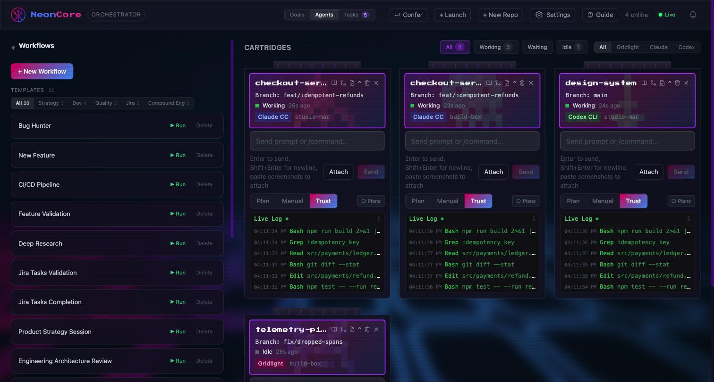
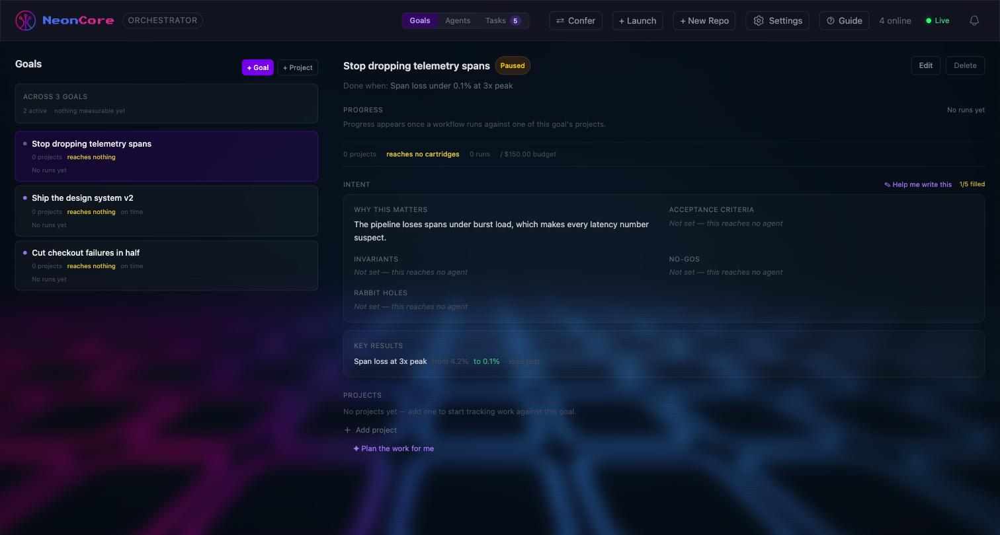
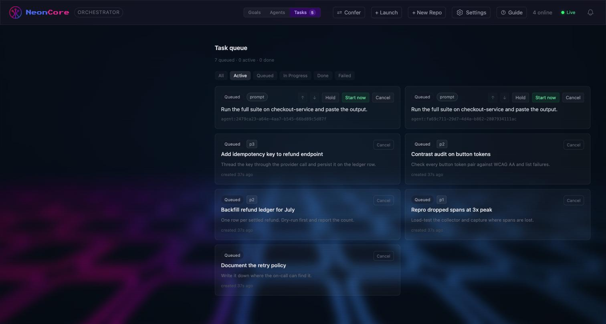

<div align="center">

# NeonCore

**An orchestrator for AI coding agents.**
Run, watch and coordinate many Claude Code, Codex and Gridlight sessions — across repos, across
machines — from one dashboard and from your phone.

[](LICENSE)
[](https://nodejs.org)
[](INSTALL.md)

</div>



---

## The problem it solves

One coding agent is easy to supervise: you watch the terminal. Five are not. They finish at
different times, they block on questions you don't see, they burn budget while you're in a
meeting, and the moment you step away from the desk you lose the thread entirely.

NeonCore turns that pile of terminals into something you can actually run:

- every agent becomes a **cartridge** — a live tile with status, branch, cost and a scrolling log
- risky tool calls **pause for approval** instead of happening while you're not looking
- work you queue **keeps moving** when one agent stalls
- and all of it is on **your phone**, so being away from the desk isn't the same as being blind

It runs entirely on your own machines. No cloud service, no account, no telemetry.

---

## Table of contents

- [How it works](#how-it-works)
- [Quick start](#quick-start) · [Connect your first agent](#connect-your-first-agent)
- [Using it: cartridges, approvals, queue](#using-it)
- [Goals and tasks](#goals-and-tasks)
- [Multiple computers](#multiple-computers-the-fleet)
- [The mobile app](#the-mobile-app)
- [Security model](#security-model)
- [Troubleshooting](#troubleshooting) · [Contributing](#contributing) · [License](#license)

---

## How it works

Three moving parts. The agent machine reports **in** over HTTP, the dashboard talks **back**
through a command channel, and the server holds the state.

```
   YOUR MACHINE (any number of repos)                      NEONCORE SERVER (:4040)
  ┌──────────────────────────────────┐                   ┌────────────────────────────┐
  │  Claude Code / Codex / Gridlight │                   │  Express + SQLite          │
  │             │                    │                   │                            │
  │   ┌─────────┴─────────┐          │   hooks POST      │   • cartridge registry     │
  │   │  hooks            │──────────┼──────────────────▶│   • activity + transcripts │
  │   │  PreToolUse       │  activity, permission asks   │   • permission gate        │
  │   │  PostToolUse      │          │                   │   • queue · goals · tasks  │
  │   │  Stop / Session   │          │                   │   • workflow executor      │
  │   └───────────────────┘          │                   │                            │
  │                                  │                   │   serves the dashboard     │
  │   ┌───────────────────┐          │   WebSocket       │   at :4040                 │
  │   │  command channel  │◀─────────┼───────────────────│                            │
  │   │  relay PTY  ─or─  │   prompts, approvals, runs   │                            │
  │   │  VS Code ext      │          │                   └─────────────┬──────────────┘
  │   └───────────────────┘          │                                 │
  └──────────────────────────────────┘                    ┌────────────┴────────────┐
                                                          │  browser        iOS app │
                                                          └─────────────────────────┘
```

**Why two channels?** Hooks are how Claude Code tells you what it is *about* to do — that is what
makes approval possible, because a `PreToolUse` hook can block until a human answers. But hooks
only talk outward. To send a prompt back *into* a session you need something attached to the
terminal, which is the relay (a PTY wrapper) or the VS Code extension. You need both halves for a
cartridge to be interactive rather than just observable.

**What's stored:** one SQLite file (`neoncore.db`) next to the server. Cartridges, activity,
transcripts, permissions, queue, goals, tasks, workflows. Delete it and you're back to zero.

---

## Quick start

Requires **Node.js 18+**.

```bash
git clone https://github.com/GRIDLIGHT-INC/neoncore.git
cd neoncore
npm install
npm run build      # builds the dashboard into server/public/
npm start          # dashboard + API on http://localhost:4040
```

Open **http://localhost:4040**. The grid will be empty — that's expected until you connect an
agent, which is the next step.

> **Save the fleet token.** On first launch the server prints one in its banner. You only need it
> to add a second computer, and it is **redacted from the settings API afterwards** — so copy it
> now or you'll be regenerating it later.

<details>
<summary><b>One-command install instead</b> (checks Node, installs, builds, starts)</summary>

```bash
./install-neoncore.sh                                              # macOS / Linux
powershell -ExecutionPolicy Bypass -File .\install-neoncore.ps1     # Windows
```
</details>

<details>
<summary><b>Development mode</b> (hot-reload dashboard)</summary>

```bash
npm run dev        # API on :4040, dashboard with HMR on :4041
```

Running a **second** server while one is already installed? Set
`NEONCORE_NO_FIRST_LAUNCH=1`. Otherwise the new instance rewrites this machine's hooks to point at
*its* port, and your existing cartridges silently stop appearing — see [Security model](#security-model).
</details>

---

## Connect your first agent

A cartridge needs **hooks** (to report) and a **command channel** (to receive). Pick one:

| | Hooks | Command channel | Best for |
|---|---|---|---|
| **Terminal relay** | auto-installed | `agent/relay` PTY wrapper | any terminal, headless boxes |
| **VS Code extension** | `agent/install.py` | `neoncore-extension` | working inside VS Code |

Fastest path — from inside the repo you want to work in:

```bash
cd ~/code/my-project
NEONCORE_URL=http://localhost:4040 python3 ~/neoncore/agent/install.py   # once per machine
node ~/neoncore/agent/relay/launch.js                                    # launches Claude Code, bridged
```

Within a second or two the repo appears as a cartridge. If it doesn't, jump to
[Troubleshooting](#troubleshooting).

> ### ⚠️ Get `<SERVER>` right the first time
>
> The installer **bakes the URL as a literal string** into `~/.claude/settings.json` and never
> re-reads it. If that address later changes, every hook POST goes nowhere — the cartridge just
> stops appearing, **with no error on either side**.
>
> | Use | How to get it | Notes |
> |---|---|---|
> | **Hostname** — `studio.local` | `hostname` | **Preferred.** Survives DHCP changes. |
> | **IP** — `192.168.4.24` | `ipconfig getifaddr en0` · `hostname -I` | Only if mDNS is blocked. **Reserve it on your router.** |
>
> Confirm it answers *from the other machine* before installing anything:
> ```bash
> curl http://<SERVER>:4040/api/health     # → {"status":"ok"}
> ```

---

## Using it

### Cartridges

Each tile is one agent in one repo. The header carries branch, status, machine and tool; the
**Live Log** underneath streams every tool call as it happens.

A cartridge leaves the grid when its session actually **ends** — going quiet does not remove it.
That distinction is deliberate: an agent that has stopped talking is usually the one you most need
to look at.

Three modes per cartridge, switchable mid-session:

| Mode | Behaviour |
|---|---|
| **Manual** | every gated tool call waits for you |
| **Trust** | auto-approves — for work you've already scoped |
| **Plan** | the agent plans, and you approve the plan rather than each step |

### Approvals

With hooks installed, a `PreToolUse` on a risky call **blocks the agent** and raises an approval —
in the dashboard and as a push notification on your phone. Nothing destructive happens while you
aren't looking. Answer from either surface and the agent resumes.

### The queue

Send work to a busy cartridge and it queues behind the current job rather than interleaving.
Lanes drain independently, a failure **halts its own lane with a reason** instead of failing
silently, and you can hold one item without stopping the rest.

---

## Goals and tasks

**Goals** are the "why" above the work: intent, budget, and what done means.



The intent fields are not decoration — **they are injected into the agent's prompt at dispatch**.
Acceptance criteria, no-gos, rabbit holes and invariants are how you fight over-reach, which is
why the panel tracks how many are filled and warns when a goal **reaches no cartridge** (a brief
that reaches nothing changes nothing, and costs nothing).

Progress has **three** states, not two: real progress, genuine zero, and *nothing to measure yet*.
An empty goal never renders as 0% — that would claim work started and got nowhere.

**Tasks** are discrete units of work you can dispatch to a cartridge.



Priority sorts them, and a **dependency gate** refuses to dispatch a task whose prerequisite hasn't
finished — overridable with `force`, but deliberately, not by default.

---

## Multiple computers: the fleet

Run a server on each computer you work from. **There is no hub and no primary.** Every server keeps
its own database and its own queue; they gossip every 15 seconds, and *clients merge at read time*.

```
        ┌──────────────┐    gossip / 15s    ┌──────────────┐
        │  studio-mac  │◀──────────────────▶│  build-box   │
        │  own DB      │                    │  own DB      │
        │  own queue   │                    │  own queue   │
        └──────┬───────┘                    └──────┬───────┘
               └──────────────┬───────────────────┘
                     ┌────────┴────────┐
                     │  browser · iOS  │   one merged grid
                     └─────────────────┘
```

This is why a machine going to sleep degrades the view instead of breaking it: the others keep
serving, and the dead one is marked stale rather than retried forever.

Adding a second computer takes one command, using the token from the first:

```bash
./install-neoncore.sh --start \
  --fleet-token <TOKEN> \
  --peer http://first-machine.local:4040
```

Both machines' cartridges now appear in one grid from either dashboard — and from the phone.
Full guide: **[FLEET.md](FLEET.md)**.

> **Prune dead peers.** A peer that has been failing for days is still advertised to every client.
> Remove it in **Settings ▸ Fleet** — a client that adopts an unreachable server wastes a request
> timeout on every refresh.

---

## The mobile app

A native iOS app (React Native — **not** Expo; see [mobile/RELEASE.md](mobile/RELEASE.md)) that
mirrors the dashboard over your LAN. Point it at one server and the rest of the fleet appears by
itself.

Six destinations: **Cartridges · Goals · Workflows · Queue · Tasks · Approvals.**

The phone is deliberately **not** a second dashboard. It is for the things that matter when you're
away from the desk — checking whether the overnight run is still moving, and unblocking it:

| On the phone | Left on the desk | Why |
|---|---|---|
| Read transcripts, answer approvals | — | the whole point of carrying it |
| Watch goals, pause a misfiring one | Drafting and decomposing goals | intent reaches every agent at dispatch — that's writing, not glancing |
| Dispatch or cancel a task | Creating and editing tasks | work is described where there's a keyboard |
| Watch the queue | Pausing a whole lane | administering a fleet is desk work |

**Setup:** install from TestFlight, open the app, enter `http://<SERVER>:4040`. It must be on the
same network — there is no cloud relay, by design. Push notifications for approvals need APNs
configured on the server (`APNS_KEY_PATH`, `APNS_KEY_ID`, `APNS_TEAM_ID`).

Build and release instructions: **[mobile/RELEASE.md](mobile/RELEASE.md)**.

---

## Security model

Read this before exposing anything beyond your LAN.

- **Designed for a trusted network.** There is no user model — anyone who can reach `:4040` can
  drive your agents. Do not port-forward it. For remote access use a VPN or a tunnel such as
  Tailscale.
- **Fleet auth is `permissive` by default**, meaning an un-tokened client is allowed but logged.
  Switch to `strict` in Settings once every client and agent carries the token. Check the server
  log for `unauthenticated` lines first — flipping to strict with a client still un-tokened takes
  that client offline instantly.
- **Agents run with your permissions.** Trust mode auto-approves tool calls, including shell
  commands. It is a real delegation of authority, so scope the work before you enable it.
- **Secrets stay out of the repo.** The fleet token lives in the database and is redacted from the
  settings API after first display. APNs keys are referenced by path via environment variables and
  are never read into the database.
- **`NEONCORE_NO_FIRST_LAUNCH=1`** stops a second server instance from rewriting this machine's
  `~/.claude/settings.json` to its own port. Set it for any dev, demo or test instance.

---

## Troubleshooting

<details>
<summary><b>A cartridge never appears</b></summary>

Almost always the baked-in URL. Check what the installer wrote:

```bash
grep -o 'http://[^"]*' ~/.claude/settings.json | sort -u
curl http://<SERVER>:4040/api/health          # from the AGENT machine, not the server
```

If the address is wrong or the server moved, re-run `agent/install.py` with the right `--url`.
</details>

<details>
<summary><b>A cartridge appears but won't take prompts</b></summary>

Hooks are working and the command channel isn't — that's the two-channel design. Launch the session
through `agent/relay/launch.js`, or install the VS Code extension. Attaching to an already-running
bare terminal is not supported.
</details>

<details>
<summary><b>Everything is slow, or one machine hangs the view</b></summary>

Look for a dead peer in **Settings ▸ Fleet** or `GET /api/peers` — a machine that is *asleep*
accepts the connection and never answers, which is far worse than one that is off. Remove it.
</details>

<details>
<summary><b>Approvals never arrive on the phone</b></summary>

APNs isn't configured, or the environment is mismatched: TestFlight builds use the **production**
gateway while Xcode debug builds use **sandbox**. That mismatch is the classic
"works in Xcode, silent in TestFlight."
</details>

---

## Repository layout

```
server/        Express + better-sqlite3 API and Socket.io (:4040)
dashboard/     React + Tailwind dashboard (Vite → server/public/)
packages/
  client/      Shared typed API client — the contract both UIs read
mobile/        Native iOS app (React Native, ejected from Expo)
agent/
  hooks/       Claude Code hooks: activity, permissions, session lifecycle
  relay/       PTY relay — the terminal command channel
  install.py   Cross-platform hook installer
extension/     VS Code extension (alternative command channel)
docs/          Feature docs, images, the work standard
```

> **One contract, two clients.** The dashboard and the mobile app both read
> `packages/client` types, and a test drives the real router to prove the client's declared
> response shapes match what the server actually sends. When they drifted, the failure was a
> screen that rendered wrong rather than an error — hence the test.

---

## Contributing

Contributions welcome — see **[CONTRIBUTING.md](CONTRIBUTING.md)**.

Every change follows **[docs/WORK-STANDARD.md](docs/WORK-STANDARD.md)**: enumerate the complete set
from the code, write a test that fails on a partial fix, fix the whole set, and paste real output.
It is enforced by hooks, not by good intentions.

```bash
npm test --workspace=server
npm test --workspace=dashboard
npm test --workspace=mobile
```

## Documentation

| Doc | What's in it |
|---|---|
| [FEATURES.md](FEATURES.md) | Complete map of what NeonCore does |
| [INSTALL.md](INSTALL.md) | Install and distribute, per-OS agent packages |
| [SETUP.md](SETUP.md) | Connecting machines: hooks, extension, relay, trust mode |
| [FLEET.md](FLEET.md) | Multi-computer setup and peer gossip |
| [WORKFLOWS.md](WORKFLOWS.md) | Canvas workflow reference |
| [docs/GOALS.md](docs/GOALS.md) · [docs/TASKS.md](docs/TASKS.md) | Goals, budgets, the task queue |
| [mobile/RELEASE.md](mobile/RELEASE.md) | Building and shipping the iOS app |
| [SECURITY.md](SECURITY.md) | Reporting a vulnerability |

## License

[Apache License 2.0](LICENSE) — Copyright 2026 Gridlight, Inc.
